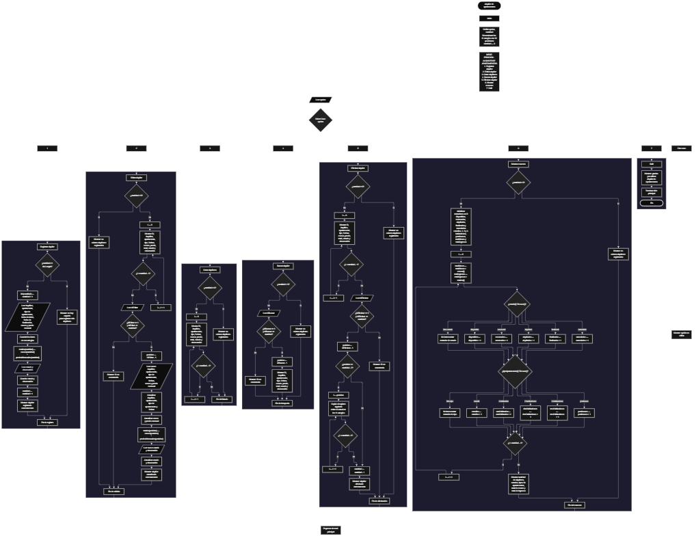

Este proyecto, llamado <b>alquiler de apartamentos</b>, fue desarrollado en <b>visual basic .net</b> como un ejercicio práctico para fortalecer la lógica de programación mediante la creación de un sistema de gestión de alquileres desde la consola. El programa cuenta con un menú principal de siete opciones que permite <b>registrar, editar, eliminar, buscar, listar y consultar un resumen</b> de los alquileres registrados. Cada alquiler almacena información como el inquilino, el apartamento, el tipo de apartamento, las fechas de inicio y finalización, la cantidad de meses, el precio mensual, el total, el estado y las observaciones, utilizando arreglos con una capacidad máxima de <b>10 alquileres durante la ejecución</b>. Durante su desarrollo se aplicaron conceptos fundamentales de programación, como variables, arreglos, estructuras condicionales, ciclos repetitivos y estructuras de selección, además de procesos para buscar, modificar, eliminar, organizar registros y calcular valores. Este proyecto permite poner en práctica los conocimientos adquiridos en Visual Basic .NET y sirve como base para desarrollar sistemas de gestión más avanzados utilizando otros lenguajes y tecnologías.

<h2 align="center">⚙️ Funcionamiento del menú principal</h2>

### ➕ Registrar alquiler

La opción <b>1) registrar alquiler</b> permite almacenar un nuevo alquiler de apartamento. Antes de realizar el registro, el sistema comprueba que la cantidad de alquileres almacenados sea menor a la capacidad máxima de los arreglos, utilizando la condición <b>cantidad &lt; ids.Length</b>. Si existe espacio disponible, asigna un identificador mediante la expresión <b>cantidad + 1</b> y solicita los datos del inquilino, apartamento, tipo de apartamento, fecha de inicio, fecha de finalización, cantidad de meses, precio mensual, estado y observación. Los datos se almacenan en la posición correspondiente de sus respectivos arreglos. Después, calcula el importe total multiplicando la cantidad de meses por el precio mensual mediante la operación <b>meses(cantidad) * preciosMensuales(cantidad)</b>. Finalmente, incrementa la variable <b>cantidad</b> en uno y muestra el mensaje <b>"alquiler registrado correctamente."</b>. Si los arreglos alcanzan su capacidad máxima de 10 registros, presenta el mensaje <b>"no hay espacio para registrar mas alquileres."</b>, impidiendo agregar otro alquiler.

### ✏️ Editar alquiler

La opción <b>2) editar alquiler</b> permite modificar la información de un alquiler registrado. Primero, el programa comprueba si existen registros mediante la variable <b>cantidad</b>. Si no hay alquileres almacenados, muestra el mensaje <b>"no existen alquileres registrados."</b>. En caso contrario, utiliza un ciclo <b>For...Next</b> para presentar la información de todos los alquileres, incluyendo su ID, inquilino, apartamento, tipo, fechas, meses, precio mensual, total, estado y observación. Después, solicita el ID del alquiler que se desea editar y comprueba que esté dentro del rango permitido mediante la condición <b>idEditar &gt;= 1 And idEditar &lt;= cantidad</b>. Si la selección es válida, calcula la posición mediante <b>idEditar - 1</b> y solicita los nuevos datos del inquilino, apartamento, tipo de apartamento, fechas, meses, precio mensual, estado y observación. El identificador se conserva y el total se vuelve a calcular multiplicando los nuevos meses por el nuevo precio mensual. Finalmente, presenta el mensaje <b>"alquiler actualizado correctamente."</b>. Si el ID seleccionado no está dentro del rango permitido, muestra el mensaje <b>"ID no encontrada."</b>.

### 📋 Listar alquileres

La opción <b>3) listar alquileres</b> permite visualizar todos los alquileres registrados actualmente en el sistema. Antes de mostrar la información, el programa comprueba si la variable <b>cantidad</b> es igual a cero. Si no existen registros, presenta el mensaje <b>"no existen alquileres registrados."</b>. Si hay alquileres disponibles, utiliza un ciclo <b>For...Next</b> para recorrer los arreglos desde la primera posición hasta la última posición ocupada. Durante el recorrido, muestra el ID, inquilino, apartamento, tipo de apartamento, fecha de inicio, fecha de finalización, meses, precio mensual, total, estado y observación de cada alquiler. Esta función facilita consultar todos los registros almacenados sin necesidad de buscar cada alquiler individualmente.

### 🔎 Buscar alquiler

La opción <b>4) buscar alquiler</b> permite localizar un alquiler mediante su identificador. Primero, el programa comprueba si existen alquileres registrados. Si el sistema está vacío, muestra el mensaje <b>"no existen alquileres registrados."</b>. En caso contrario, solicita el ID del alquiler que se desea buscar y comprueba que esté dentro del rango permitido mediante la condición <b>idBuscar &gt;= 1 And idBuscar &lt;= cantidad</b>. Si el ID es válido, calcula la posición correspondiente utilizando <b>idBuscar - 1</b> y muestra toda la información del alquiler seleccionado: ID, inquilino, apartamento, tipo, fechas, meses, precio mensual, total, estado y observación. Si el identificador introducido no corresponde al rango de registros disponibles, presenta el mensaje <b>"ID no encontrada."</b>. Esta operación utiliza el ID para acceder directamente a la posición del alquiler en los arreglos.

### 🗑️ Eliminar alquiler

La opción <b>5) eliminar alquiler</b> permite eliminar un alquiler registrado mediante su identificador. Antes de comenzar, el programa comprueba que existan alquileres almacenados. Si no hay registros, muestra el mensaje <b>"no existen alquileres registrados."</b>. Si existen alquileres, presenta una lista con toda la información almacenada para facilitar la selección. Después, solicita el ID del alquiler que se desea eliminar y verifica que esté dentro del rango permitido mediante la condición <b>idEliminar &gt;= 1 And idEliminar &lt;= cantidad</b>. Si el ID es válido, calcula la posición mediante <b>idEliminar - 1</b> y utiliza un ciclo <b>For...Next</b> para desplazar una posición hacia la izquierda los datos de los registros posteriores en los once arreglos: <b>ids, inquilinos, apartamentos, tiposApartamento, fechasInicio, fechasFinalizacion, meses, preciosMensuales, totales, estados y observaciones</b>. Finalmente, disminuye la variable <b>cantidad</b> en uno y muestra el mensaje <b>"alquiler eliminado correctamente."</b>. Si el identificador no está dentro del rango permitido, presenta el mensaje <b>"ID no encontrada."</b>. El desplazamiento mantiene los registros activos agrupados en las primeras posiciones de los arreglos.

### 📊 Mostrar resumen

La opción <b>6) mostrar resumen</b> permite consultar estadísticas generales de los alquileres registrados. Primero, el programa comprueba si existen registros almacenados. Si no hay alquileres, muestra el mensaje <b>"no existen alquileres registrados."</b>. En caso contrario, inicializa contadores para clasificar los alquileres según sus estados: <b>disponibles, reservados, alquilados, finalizados y cancelados</b>. También inicializa contadores para clasificar los apartamentos según sus tipos: <b>estudios, apartamentos de una habitación, dos habitaciones, tres habitaciones y penthouses</b>. Después, utiliza un ciclo <b>For...Next</b> para recorrer los registros y acumular la cantidad total de meses mediante <b>totalMeses += meses(i)</b> y los ingresos mediante <b>totalIngresos += totales(i)</b>. Durante el recorrido, utiliza estructuras <b>If...ElseIf</b> y el método <b>ToLower()</b> para identificar los estados y tipos de apartamento sin distinguir entre mayúsculas y minúsculas. Finalmente, muestra la cantidad de alquileres, los conteos por estado, los conteos por tipo de apartamento, el total de meses y el total de ingresos. Esta función permite obtener una visión general de la información almacenada en el sistema.

### 🚪 Salir del menú principal

La opción <b>7) salir</b> está destinada a finalizar la ejecución del programa y muestra el mensaje <b>"gracias por utilizar Alquiler de Apartamentos."</b>. El menú principal se encuentra dentro de una estructura repetitiva <b>Do...Loop While</b>, que mantiene el programa en funcionamiento mientras la opción seleccionada sea diferente de <b>7</b>. Cuando el usuario selecciona esta opción, la condición <b>opcion &lt;&gt; 7</b> deja de cumplirse y el ciclo termina correctamente, finalizando la ejecución del programa.

<h2 align="center">🧠 Temas aplicados en el proyecto</h2>

### 📦 Variables

En este proyecto se utilizan variables para almacenar y controlar la información de los alquileres, administrar la cantidad de registros, guardar la opción seleccionada en el menú, identificar los alquileres que se desean editar, buscar o eliminar y realizar los cálculos necesarios para generar el resumen. También se utilizan variables auxiliares para contar los estados y tipos de apartamentos, así como para acumular los meses y los ingresos. Cada variable cumple una función específica dentro de las operaciones del sistema.

🔢 **Opcion:** Almacena la opción seleccionada por el usuario en el menú principal.

📊 **Cantidad:** Controla el número actual de alquileres registrados y permite determinar las posiciones ocupadas de los arreglos.

🆔 **IdEditar:** Almacena el identificador del alquiler que se desea modificar.

🔎 **IdBuscar:** Almacena el identificador del alquiler que se desea consultar.

🗑️ **IdEliminar:** Almacena el identificador del alquiler que se desea eliminar.

📍 **Posicion:** Determina la posición del arreglo correspondiente al ID seleccionado, mediante la operación ID menos uno.

🔄 **I:** Funciona como contador en los ciclos <b>For...Next</b> y permite recorrer los registros, mostrar información y desplazar los datos durante la eliminación.

📊 **Disponibles, Reservados, Alquilados, Finalizados y Cancelados:** Almacenan la cantidad de alquileres clasificados según su estado.

🏠 **Estudios, UnaHabitacion, DosHabitaciones, TresHabitaciones y Penthouses:** Almacenan la cantidad de apartamentos clasificados según su tipo.

📅 **TotalMeses:** Acumula la cantidad de meses correspondientes a todos los alquileres registrados.

💰 **TotalIngresos:** Acumula los importes totales de los alquileres registrados.

### 🗃️ Arreglos

En este proyecto se utilizan once arreglos relacionados con la información de cada alquiler. Cada arreglo tiene una capacidad de <b>10 posiciones</b>, comprendidas entre los índices <b>0 y 9</b>, y utiliza el mismo índice para representar los datos correspondientes a un mismo registro. Por ejemplo, la información del alquiler almacenado en la posición <b>0</b> se encuentra distribuida entre <b>ids(0), inquilinos(0), apartamentos(0), tiposApartamento(0), fechasInicio(0), fechasFinalizacion(0), meses(0), preciosMensuales(0), totales(0), estados(0) y observaciones(0)</b>. Esta organización permite recorrer, buscar, modificar, mostrar y eliminar los alquileres de manera ordenada.

🆔 **Ids(10):** Almacena los identificadores asignados a los alquileres registrados.

👤 **Inquilinos(10):** Almacena los nombres de los inquilinos.

🏢 **Apartamentos(10):** Almacena la identificación o descripción de los apartamentos.

🏠 **TiposApartamento(10):** Almacena los tipos de apartamentos, como estudio, una habitación, dos habitaciones, tres habitaciones y penthouse.

📅 **FechasInicio(10):** Almacena las fechas de inicio de los alquileres.

📅 **FechasFinalizacion(10):** Almacena las fechas de finalización de los alquileres.

🔢 **Meses(10):** Almacena la cantidad de meses correspondientes a cada alquiler.

💰 **PreciosMensuales(10):** Almacena el precio mensual de cada alquiler.

🧮 **Totales(10):** Almacena el importe total calculado para cada alquiler.

📌 **Estados(10):** Almacena el estado actual de cada alquiler.

📝 **Observaciones(10):** Almacena las observaciones adicionales de cada alquiler.

### 🔀 Estructuras condicionales

En este proyecto se utilizan las estructuras <b>If...Then, ElseIf y Else</b> para comprobar si existe espacio disponible antes de registrar un alquiler, verificar si hay registros almacenados antes de realizar determinadas operaciones, validar los identificadores seleccionados para editar, buscar o eliminar alquileres y clasificar los registros según su estado y tipo de apartamento. Estas condiciones permiten que el programa responda de manera diferente según la información almacenada y el resultado de cada comprobación.

### 🔄 Estructuras repetitivas

En este proyecto se utilizan los ciclos <b>Do...Loop While</b> y <b>For...Next</b>. El ciclo <b>Do...Loop While</b> mantiene activo el menú principal y permite ejecutar diferentes operaciones hasta que el usuario selecciona la opción 7. Por otro lado, los ciclos <b>For...Next</b> permiten recorrer los arreglos para mostrar los alquileres, consultar sus datos y calcular las estadísticas del resumen. También se utilizan para desplazar los registros posteriores una posición hacia la izquierda durante la eliminación de un alquiler.

### 🎯 Estructura Select Case

El programa utiliza la estructura <b>Select Case</b> para evaluar el valor almacenado en la variable <b>opcion</b> y ejecutar el bloque de instrucciones correspondiente. Cada caso representa una operación específica del sistema: <b>registrar, editar, listar, buscar, eliminar, mostrar resumen o salir</b>. También se utiliza el bloque <b>Case Else</b> para mostrar el mensaje <b>"opcion no valida."</b> cuando el usuario introduce un número que no coincide con ninguna de las opciones definidas en el menú principal.

### 🔢 Dimensionamiento de arreglos

El programa utiliza la declaración de arreglos mediante la instrucción <b>Dim</b> para establecer la capacidad de almacenamiento de los datos de los alquileres. Se definieron <b>11 arreglos con 10 posiciones cada uno</b>, lo que permite administrar hasta 10 alquileres durante la ejecución. Es importante tener en cuenta que, en Visual Basic .NET, una declaración como <b>Dim ids(9) As Integer</b> establece los índices desde <b>0 hasta 9</b>, proporcionando diez posiciones disponibles. La cantidad de registros ocupados se controla mediante la variable <b>cantidad</b>, por lo que las operaciones recorren únicamente las posiciones que contienen alquileres registrados.

### 🔄 Reorganización de registros

Cuando se selecciona un alquiler para eliminarlo, el programa utiliza un ciclo <b>For...Next</b> que comienza en la posición seleccionada y llega hasta <b>cantidad - 2</b>. En cada repetición, los datos de la posición siguiente se copian sobre la posición actual en los once arreglos. De esta manera, los registros posteriores ocupan las posiciones disponibles sin dejar espacios vacíos entre los alquileres activos. Después, la variable <b>cantidad</b> disminuye en uno para actualizar el número de registros almacenados. Sin embargo, los identificadores originales no se renumeran después del desplazamiento, por lo que la relación directa entre el ID y la posición del arreglo puede dejar de coincidir tras eliminar un registro intermedio.

### 🧮 Operaciones aritméticas y acumuladores

En este proyecto se utilizan operaciones aritméticas para calcular el importe total de cada alquiler y obtener estadísticas generales. Durante el registro y la edición, el programa multiplica la cantidad de meses por el precio mensual mediante la expresión <b>meses(cantidad) * preciosMensuales(cantidad)</b> o <b>meses(posicion) * preciosMensuales(posicion)</b>, según corresponda. Además, utiliza los operadores <b>+=</b> para acumular los meses de todos los alquileres y sumar sus importes totales en las variables <b>totalMeses</b> y <b>totalIngresos</b>. Estas operaciones permiten calcular los valores económicos y las estadísticas que se presentan en el resumen.

<h2 align="center">¿Cómo se implementaron las operaciones crud en el proyecto?</h2>

Las operaciones <b>crud</b> se implementaron mediante las opciones del menú principal, permitiendo administrar los alquileres registrados. La operación <b>crear</b> corresponde a <b>registrar alquiler</b>, donde se introducen los datos de un nuevo alquiler; <b>leer</b> se realiza mediante las opciones <b>buscar alquiler y listar alquileres</b>, que permiten consultar la información almacenada; <b>actualizar</b> corresponde a <b>editar alquiler</b>, donde se modifican los datos de un registro existente; y <b>eliminar</b> se realiza mediante la opción <b>eliminar alquiler</b>, que retira un registro y reorganiza los datos de los arreglos. Adicionalmente, la opción <b>mostrar resumen</b> permite obtener estadísticas generales sobre los estados, tipos de apartamentos, meses e ingresos. Todas estas operaciones utilizan variables, arreglos, condicionales y ciclos para gestionar la información temporalmente durante la ejecución del programa.

<h2 align="center">Diagrama de flujo del proyecto</h2>

<h2 align="center">🛡️ Validaciones del programa</h2>

### 📭 No existen alquileres registrados

Esta validación se utiliza en las opciones de <b>editar, listar, buscar, eliminar y mostrar resumen</b>. El programa comprueba si la variable <b>cantidad</b> es igual a <b>0</b> y, si no existen alquileres registrados, muestra el mensaje <b>"no existen alquileres registrados."</b>. Esta comprobación evita continuar con las operaciones que necesitan información almacenada cuando el sistema está vacío.

### ⚠️ Capacidad máxima de alquileres

Esta validación se utiliza durante el registro de nuevos alquileres para controlar la capacidad máxima de los arreglos. El programa comprueba si <b>cantidad &gt;= ids.Length</b> antes de permitir agregar un nuevo registro. Como los arreglos tienen una capacidad de 10 posiciones, el sistema impide registrar más alquileres cuando se alcanza ese límite y muestra el mensaje <b>"no hay espacio para registrar mas alquileres."</b>.

### ❌ ID no encontrada

Esta validación se utiliza en las operaciones de <b>editar, buscar y eliminar alquiler</b>. El programa comprueba que el identificador introducido sea mayor o igual a <b>1</b> y menor o igual a <b>cantidad</b>. Si el ID se encuentra dentro del rango permitido, calcula la posición mediante la expresión <b>ID - 1</b> y realiza la operación correspondiente. En caso contrario, muestra el mensaje <b>"ID no encontrada."</b>. Esta comprobación permite controlar que el identificador seleccionado se encuentre dentro del rango de registros disponibles.

### 🧮 Cálculo del importe total

Esta operación se realiza durante el registro y la edición de alquileres. El programa multiplica la cantidad de meses por el precio mensual y almacena el resultado en el arreglo <b>totales</b>. De esta manera, cada alquiler mantiene actualizado su importe total de acuerdo con los valores introducidos por el usuario.

### 📊 Clasificación de estados y tipos de apartamentos

Esta validación se utiliza en la opción <b>mostrar resumen</b>. El programa convierte los textos almacenados mediante el método <b>ToLower()</b> y compara los valores con los estados <b>"disponible", "reservado", "alquilado", "finalizado" y "cancelado"</b>. También compara los tipos de apartamento con <b>"estudio", "1 habitacion", "2 habitaciones", "3 habitaciones" y "penthouse"</b>. Cuando encuentra una coincidencia, incrementa el contador correspondiente. Los valores que no coinciden con estas categorías no se incluyen en los contadores de clasificación.

### ⚠️ Correspondencia de identificadores

El programa asigna los identificadores utilizando la expresión <b>cantidad + 1</b> y accede a los registros mediante la operación <b>ID - 1</b>. Durante la eliminación, los datos se desplazan hacia la izquierda, pero los identificadores almacenados no se renumeran. Por este motivo, si se elimina un alquiler intermedio, los identificadores pueden dejar de corresponder con las posiciones reales de los registros. Además, al registrar otro alquiler, el programa puede asignar un identificador que ya existe. Esta situación representa una limitación de la lógica actual del sistema y debe tenerse en cuenta al realizar operaciones posteriores a una eliminación.

### ⚠️ Entrada de datos

El programa utiliza <b>Convert.ToInt32()</b> y <b>Convert.ToDouble()</b> para convertir los valores introducidos por el usuario en números enteros y decimales, respectivamente. Sin embargo, el código no utiliza mecanismos adicionales como <b>TryParse()</b> para comprobar previamente si los datos introducidos tienen un formato numérico válido. Por esta razón, una entrada incorrecta puede generar una excepción durante la ejecución. Asimismo, las fechas, los nombres y los demás campos de texto se almacenan directamente sin realizar validaciones específicas de formato o campos vacíos.

### ❌ Opción inválida

La estructura <b>Select Case</b> incluye el bloque <b>Case Else</b>, que muestra el mensaje <b>"opcion no valida."</b> cuando el usuario introduce un número que no corresponde a ninguna de las opciones definidas en el menú principal. Esta comprobación permite informar al usuario cuando selecciona una operación que no está disponible.

<h2 align="center">🎯 Objetivo del proyecto</h2>

El objetivo principal de este proyecto es fortalecer la <b>lógica de programación</b> mediante el desarrollo de un sistema de gestión de alquileres de apartamentos en <b>visual basic .net</b>. A través de su construcción se busca aplicar los conocimientos adquiridos sobre variables, arreglos, estructuras condicionales, ciclos repetitivos y estructuras de selección, integrándolos para resolver un problema de manera organizada. Además, el proyecto permite comprender cómo registrar, consultar, modificar y eliminar información, calcular importes de alquiler y generar resúmenes estadísticos en una aplicación de consola, estableciendo una base para desarrollar sistemas de gestión más completos con otros lenguajes y tecnologías.

